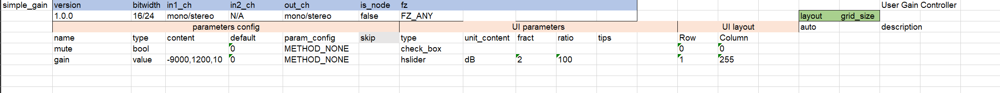
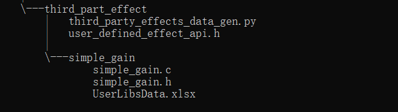
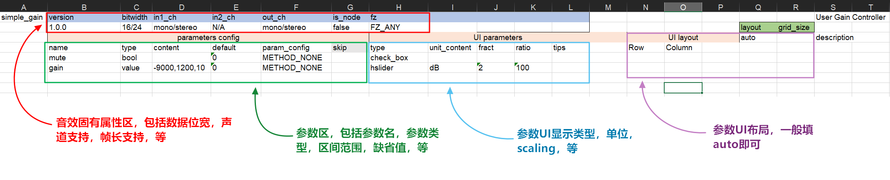
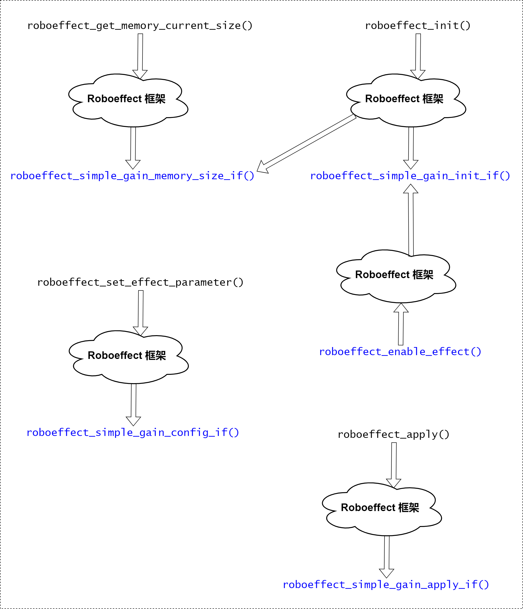
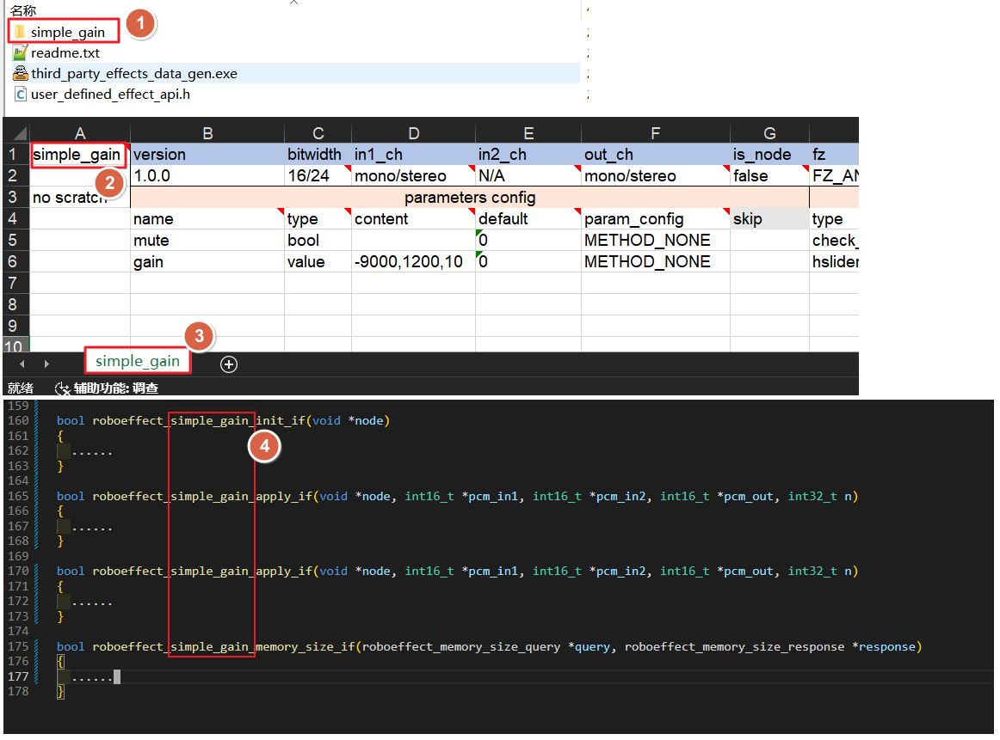
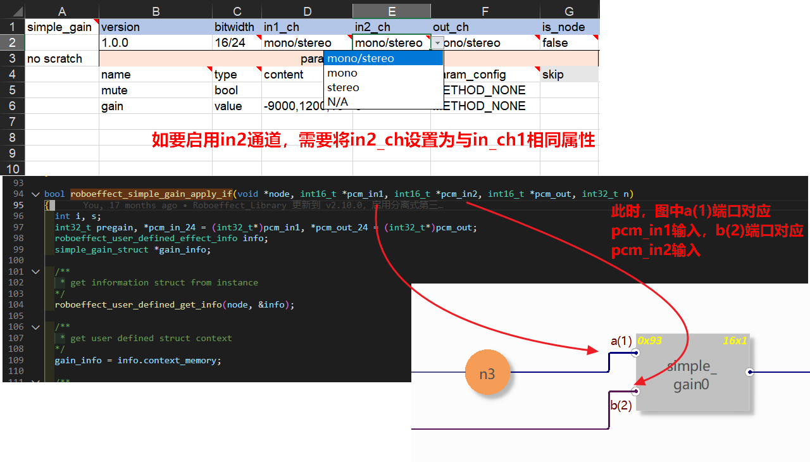
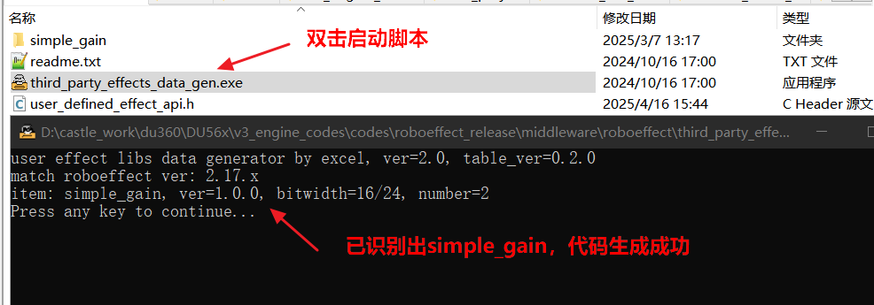
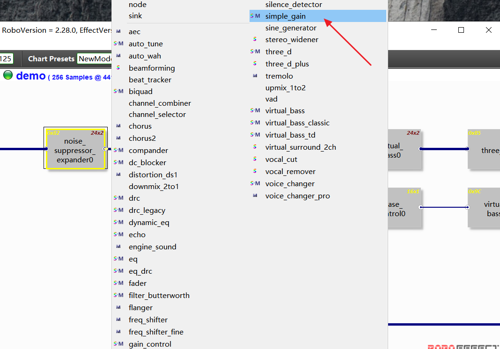
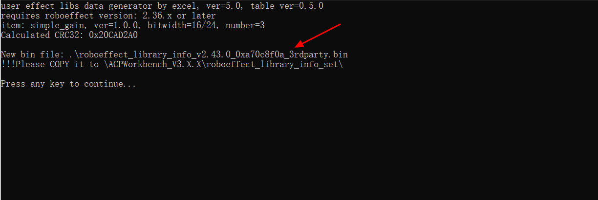
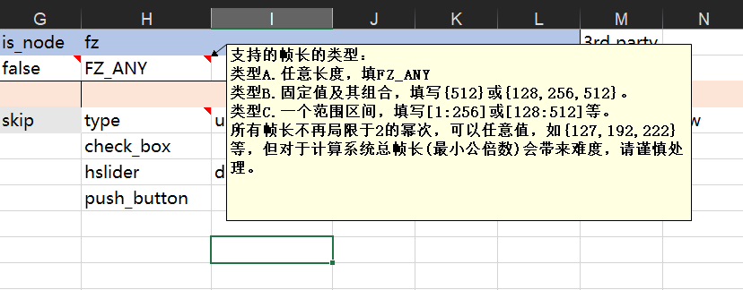

- [x] 可外发
- [ ] 不可外发

<center><font size=6>Roboeffect 第三方音效集成指南</font></center>


# 1. 自定义（第三方）音效集成方法
Roboeffect允许用户将自定义的音效库集成到Roboeffect库中，在Acpworkbench描绘音效通路图时，可使用这个音效作为节点，使用方式和效果等同于Roboeffect内置的音效。


## 1.1. 添加自定义音效的基本流程
添加一个自定义音效的流程可以概括为3个步骤：属性描述，接口交互，集成编译。
下面简单说明一下这三个步骤的具体内容。

### 1.1.1. 属性描述
属性描述为描述这个自定义音效的完整属性，比如音效名称，支持的数据位宽，声道数，输入参数的个数及属性，等。

roboeffect框架使用excel文件 UserLibsData.xlsx 对音效进行描述，excel文件内容大致是这个样子的：

关于每个单元格的填写内容和注意事项，请悬浮鼠标到列标题项，excel会自动弹出注释。

### 1.1.2. 框架交互接口
框架交互接口是实现用户代码和roboeffect框架交互的接口函数。在Roboeffect框架中必须实现4个接口，分别为初始化接口 init( )，参数配置接口 config( )，内存用量查询接口 memory_size( )，及运行接口 apply( )。

### 1.1.3. 集成编译
以上工作完成后，只需执行框架提供的脚本生成内嵌代码，重新编译工程，自定义音效的集成就完成了。

## 1.2. 添加一个 simple_gain 音效
下面以一个简单的例子来说明这套流程，假使我们需要添加一个名为 simple_gain 的音效；

### 1.2.1. 前期准备

文件组织结构
所有和第三方音效有关的文件都存在于 third_part_effect 目录中，比如 simple_gain 的相关文件，放在simple_gain文件夹( 需要和音效名完全一致 )下单独维护：


### 1.2.2. simple_gain 的属性描述
首先我们来看一下 simple_gain 的属性描述，打开 UserLibsData.xlsx，可以看到这几个区域：

关于每个单元格的填写内容和注意事项，请悬浮鼠标到列标题项，excel会自动弹出注释。

### 1.2.3. simple_gain 的框架接口函数
前文说到，每个音效需要实现初始化接口，参数配置接口，内存用量查询接口，运行接口，共4个与框架交互的接口函数。

以 simple_gain 为例，4个框架接口的函数实现放在 simple_gain.c 内，请严格按照此命名规则对框架接口函数进行命名。

函数名及作用见下表：

| 函数名  | 作用                      | 被调用的时机   |
| ------ | ----------------------------- | ---------- |
| roboeffect_simple_gain_init_if( ) | 初始化音效上下文内存  | 音效被开启时，或某些初始化参数被设置时 |
| roboeffect_simple_gain_config_if( ) | 为音效设置参数   | 参数被设置 |
| roboeffect_simple_gain_apply_if( ) | 运行音效算法   | 引擎运行一帧(roboeffect_apply( ))时被调用一次 |
| roboeffect_simple_gain_memory_size_if( ) | 报告内存使用量   | 查询内存用量时被调用 |


这4个框架接口函数被调用的时机也有所不同，如下图：


<span style="font-size: 18px; color: red;">请注意：</span>
请使用C语言变量风格对音效进行命名，如 simple_gain。一旦命名确定后，位于如下几处的名称必须保持一致：



### 1.2.4. roboeffect_simple_gain_init_if( )
roboeffect_simple_gain_init_if( ) 接口会在打开音效时被 Roboeffect 框架自动调用，此接口可以调用音效的原生初始化函数对内存进行初始化。simple_gain 的 roboeffect_simple_gain_init_if( ) 接口实现如下：
```c
bool roboeffect_simple_gain_init_if(void *node)
{
	uint8_t *context_ptr;
	roboeffect_user_defined_effect_info info;
	simple_gain_struct *gain_info;

	/**
	 * get information struct from instance and save to info
	*/
	roboeffect_user_defined_get_info(node, &info);

	/**
	 * get user defined context memory
	*/
	gain_info = info.context_memory;

	/**
	 * initialize the context of the effect
	*/
	gain_info->data_a = 0xAB;
	gain_info->data_b = 0xCD;

	return TRUE;
}
```

### 1.2.5. roboeffect_simple_gain_config_if( )接口
roboeffect_simple_gain_config_if( ) 接口会在音效参数变化时被 Roboeffect 框架调用，如果当前参数的变化涉及到原生音效函数的调用，可以在roboeffect_simple_gain_config_if( ) 接口中执行。simple_gain 的 config( ) 接口实现如下：
```c
bool roboeffect_simple_gain_config_if(void *node, int16_t *new_param, uint8_t param_num, uint8_t len)
{
	int ret;
	uint8_t method_flag = 0;
	roboeffect_user_defined_effect_info info;
	simple_gain_struct *gain_info;

	/**
	 * check parameters and update to effect instance
	*/
	if(ROBOEFFECT_ERROR_OK > roboeffect_user_defined_params_check(node, new_param, param_num, len, &method_flag))
	{
		return FALSE;
	}

	/**
	 * get information struct from instance
	*/
	roboeffect_user_defined_get_info(node, &info);

	/**
	 * get user defined struct
	*/
	gain_info = info.context_memory;

	if((method_flag & METHOD_CFG_1) && info.is_active)
	{
		//Call APIs for changed parameters that have the METHOD_CFG_1 tag.
	}

	if((method_flag & METHOD_CFG_2) && info.is_active)
	{
		//Call APIs for changed parameters that have the METHOD_CFG_2 tag.
	}

	return TRUE;
}
```

每个参数都有一个参数变化的属性(tag)，表示这个参数变化时，需要执行工作流程。


主要有三个类别：

A. METHOD_NONE
METHOD_NONE属性的参数变化时，不会做任何额外操作。

B. METHOD_INIT
METHOD_INIT属性的参数变化时，Roboeffect 框架架会自动调用 init( ) 接口。一般此类参数必须在音效初始化期被设置。

C. METHOD_CFG_1，METHOD_CFG_2，METHOD_CFG_3
此类属性的参数变化时，会调用具体的音效函数进行配置，如 roboeffect_simple_gain_config_if( ) 实现中这个空操作，表示具有METHOD_CFG_1属性的参数发生了变化，需要调用额外的音效函数去配置这个变化。

```c
	...
	if((method_flag & METHOD_CFG_1) && info.is_active)
	{
		//Call APIs for changed parameters that have the METHOD_CFG_1 tag.
	}
	...
```

在这个判断里，可以直接调用 info.parameters[ ] 对音效进行配置，此时的 info.parameters[ ] 已经是最新的参数了

### 1.2.6. roboeffect_simple_gain_apply_if( )接口
apply 接口在 Roboeffect 处理一帧时调用一次。simple_gain 的 apply( ) 接口实现如下：
```c
bool roboeffect_simple_gain_apply_if(void *node, int16_t *pcm_in1, int16_t *pcm_in2, int16_t *pcm_out, int32_t n)
{
	int i, s;
	int32_t pregain, *pcm_in_24 = (int32_t*)pcm_in1, *pcm_out_24 = (int32_t*)pcm_out, block, bits_with;
	roboeffect_user_defined_effect_info info;
	simple_gain_struct *gain_info;

	/**
	 * get information struct from instance
	*/
	roboeffect_user_defined_get_info(node, &info);

	/**
	 * get user defined struct context
	*/
	gain_info = info.context_memory;
	
	/**
	 * apply data
	*/

	//info.parameters[0] is dB, convert it to Q3.12.
	pregain = db_to_scaling(((float)info.parameters[1])/100, SCALING_Q12_MAX);

	//apply effect in segments
	block = n / info.framesize_running;

	bits_with = (info.width == BITS_24) ? (2) : (1);

	//process gain controller
	if(block > 0)
	{
		while(block--)
		{
			if(info.width == BITS_24)
			{
				for(s = 0; s < n; s++)
				{
					if(info.ch_num == 2)
					{
						pcm_out_24[2 * s + 0] = __nds32__clips((((int64_t)pcm_in_24[2 * s + 0] * pregain + 2048) >> 12), (24)-1);
						pcm_out_24[2 * s + 1] = __nds32__clips((((int64_t)pcm_in_24[2 * s + 1] * pregain + 2048) >> 12), (24)-1);
					}
					else
					{
						pcm_out_24[s] = __nds32__clips((((int64_t)pcm_in_24[s] * pregain + 2048) >> 12), (24)-1);
					}
				}
			}
			else if(info.width == BITS_16)
			{
				for(s = 0; s < n; s++)
				{
					if(info.ch_num == 2)
					{
						pcm_out[2 * s + 0] = __nds32__clips((((int32_t)pcm_in1[2 * s + 0] * pregain + 2048) >> 12), (16)-1);
						pcm_out[2 * s + 1] = __nds32__clips((((int32_t)pcm_in1[2 * s + 1] * pregain + 2048) >> 12), (16)-1);
					}
					else
					{
						pcm_out[s] = __nds32__clips((((int32_t)pcm_in1[s] * pregain + 2048) >> 12), (16)-1);
					}
				}
			}

			pcm_in1 += info.framesize_running * info.ch_num * bits_with;
			pcm_out += info.framesize_running * info.ch_num * bits_with;
		}
	}

	return TRUE;
}
```

| 参数名  | 解释                      |  说明  |
| ------ | ----------------------------- | ---------- |
| node | 音效内存上下文  |  |
| pcm_in1 | 指向默认输入通道的pcm数据指针，多通道时指向a(1)通道   |  |
| pcm_in2 | 指向输入通道的pcm数据指针，多通道时指向b(2)通道   |  |
| pcm_out | 指向输出通道的pcm数据指针   |  |
| n | 输入和输出数据的帧长，按sample计   |  |

其中，参数 *pcm_in1, *pcm_in2, *pcm_out 分别代表了PCM数据的输入和输出。Roboeffect框架支持最多两路PCM的输入和一路PCM的输出，同时这三路的PCM数据的位宽和声道数必须相同，如同时为24bit 双声道。
关于pcm_in2的启用，以及pcm_in1 和 pcm_in2 的输入顺序如下图所示：


<span style="font-size: 18px; color: red;">请注意：</span>
在单输入通道的场景下，由于内存优化的关系，pcm_in1 和 pcm_out 有可能会指向同一片内存，请做好数据保护工作！


### 1.2.7. roboeffect_simple_gain_memory_size_if( )接口
roboeffect_simple_gain_memory_size_if 需要返回三块内存的使用量，返回变量名及功能如下：

| 内存块名  | 解释                      |  说明  |
| ------ | ----------------------------- | ---------- |
| context_memory_size | 音效内存  | 为音效独占 |
| scratch_memory_size | 共享内存   | 非持续型数据可以保存于此，与其他音效共享 |

roboeffect_simple_gain_memory_size_if 实现如下：

A. context_memory_size 即为 simple_gain_struct 结构体大小，作为音效上下文使用

B. additional_memory_size 分配16字节为例 (此参数最新版本不再使用，设0即可)

C. scratch_memory_size 如不使用scratch memory，设0即可

```c
bool roboeffect_simple_gain_memory_size_if(roboeffect_memory_size_query *query, roboeffect_memory_size_response *response)
{
	int32_t max_delay_samples = ceilf(query->params[0] * query->sample_rate / 1000.0f);

  //simpl_gain的context memory即为simple_gain_struct结构体的大小
	response->context_memory_size = sizeof(simple_gain_struct);

	//最新版本不再使用additional_memory_size，固定设0
	response->additional_memory_size = 0;

  //simpl_gain不使用scratch memory
	response->scratch_memory_size = 0;

	return TRUE;
}
```


### 1.2.8. 运行集成脚本
以上工作完成后，即可双击 third_party_effects_data_gen.exe 脚本：



如上图的运行接口，说明内嵌代码已经在 user_defined_effect_api.h 文件中生成，之后就可以进行正常编译固件，并下载和调音了。
在调音工具中，添加音效是，就可以看到菜单里已经存在 simple_gain 音效：


### 1.2.9. 包含第三方音效信息的roboeffect_library_info.bin文件
运行 third_party_effects_data_gen.exe 脚本后，会重新生成一个带第三方音效信息的 roboeffect_library_info.bin 文件（前提是执行脚本前，将标准的 roboeffect_library_info.bin 文件放入平行目录）



引擎版本从v2.43.0开始，可以生成带有crc校验码的 roboeffect_library_info.bin，如：
```bash
roboeffect_library_info_v2.43.0_0x20cad2a0_3rdparty.bin
```
这样的好处是，上位机在缺少音效信息时，可以通过crc码精确提示需要加载的信息bin文件，方便客户快速找到当前参数匹配的bin数据。

同时，为了方便客户检查诸如 roboeffect_library_info_v2.43.0_3rdparty.bin 文件中的第三方音效信息，可以执行以下命令查看：
```bash
>>third_party_effects_data_gen.exe -c roboeffect_library_info_v2.43.0_0x20cad2a0_3rdparty.bin
info_v2.42.0_0xaa363cff_3rdparty.bin
user effect libs data generator by excel, ver=5.0, table_ver=0.5.0
requires roboeffect version: 2.36.x or later
buildin effect: 76
3rd party effect: 1
list 3rd party:
name=simple_gain,  ver=1.0.0
```


## 1.3. 音效属性excel表的数据详解
以 simple_gain/UserLibsData.xlsx 为例，一般预设的类型都有下拉列表供选择，防止输入非预期的值：


但具体的值（比如参数范围和步进，等），还需要手动填写，最新版本的excel表已经对每个参数如何填写做了详细说明，请悬浮鼠标弹出注释：


### 1.3.1. 帧长选择
从 Roboeffect version v2.31.0 开始，所有音效支持更为灵活的帧长选择，见 fz 列的注释：


此规则支持三种格式：

类型A. 任意长度，填 FZ_ANY

类型B. 固定值及其组合，填写 {512} 或 {128,256,512} 。

类型C. 一个范围区间，填写 [1:256] 或 [128:512] 等。

所有帧长不再局限于2的幂次，可以任意值，如{127,192,222}等，但对于计算系统总帧长(最小公倍数)会带来难度，请谨慎处理。

系统会根据所有音效帧长的配置，计算一个最恰当的帧长作为**系统帧长**，即**全局帧长**；同时也为每个音效计算一个最适配的**音效帧长**

可以通过 roboeffect_user_defined_get_info( ) 接口获得到当前自定义音效的**音效帧长**，供初始化和运行期使用（某些音效需要在初始化时确定帧长值）：
```c
......
roboeffect_user_defined_get_info(node, &info);
effect framesize = info.framesize_running;
......
```


## 1.4. 用户自定义音效相关接口描述
用户自定义音效的代码需要用户自己来实现，所有代码集中在 init( )，config( )，apply( )，memory_size( ) 四个接口中，而这四个接口是回调函数类型，框架在运行期适当的时机调用接口。因此用户在实现接口时，需要获悉一些状态信息（如上下文指针，当前音效的帧长，采样率，数据位宽，哪个参数变化了，等等），或者进行一些 roboeffect 框架层间的操作（比如分配额外内存）。Roboeffect 提供了一组接口方便实现。

### 1.4.1. roboeffect_user_defined_get_info( )
roboeffect_user_defined_get_info() 接口在 init( )，config( )，apply( ) 三个接口中都可以使用，用于返回一个当前音效信息的结构体：
```c
typedef struct _roboeffect_user_defined_effect_info
{
	uint32_t sample_rate;
	uint8_t ch_num;
	uint8_t parameters_len;
	roboeffect_width width;
	uint16_t framesize_running;
	void* context_memory;
	void* additional_memory;

	int16_t* parameters;
	int16_t* parameters_backup;
	param_act_method param_act;

	bool is_active;
} roboeffect_user_defined_effect_info;//
```

### 1.4.2. roboeffect_user_defined_params_check( )
roboeffect_user_defined_params_check() 接口仅仅用于 config( ) 接口，用于更新用户参数值，同时获悉参数的变化属性，方便用户调用额外的函数去处理这些参数的变化。
```c
bool roboeffect_user_gain_config_if(void *node, int16_t *new_param, uint8_t param_num, uint8_t len)
{
	......

	/**
	 * check parameters and update to effect instance
	*/
	if(ROBOEFFECT_ERROR_OK > roboeffect_user_defined_params_check(node, new_param, param_num, len, &method_flag))
	{
		return FALSE;
	}
	......
}
```

请注意，method_flag 变量反应了变化参数的属性集合，譬如我们将mute参数设为 METHOD_CFG_1：


那么，在调音端或者音效控制端，mute参数有改变时，就会落进这个 if 判断，在这里就可以使用专用接口来配置mute：

```c
if((method_flag & METHOD_CFG_1) && info.is_active)
{
	//Calls APIs for changed parameters that have the METHOD_CFG_1 tag.
}
```


## 1.5. 用户自定义音效相关函数定义
自定义音效函数API指用户在集成自定义的音效时，在框架接口中使用的API。

### 1.5.1. roboeffect_user_defined_get_info( )
功能：获取当前音效信息的结构体，可以在init(), config(), apply()三个接口中使用。

| 函数原型   |
| ------ |
|ROBOEFFECT_ERROR_CODE roboeffect_user_defined_get_info( void *node, roboeffect_user_defined_effect_info *info )|

输入参数描述：
| 参数   | 类型结构                      | 推荐值   |
| ------ | ----------------------------- | ---------- |
| node | void *          | init( ), config( ), apply( ) 三个接口传入的第一个参数，用以描述当前的音效节点 |
| info | roboeffect_user_defined_effect_info *         | output，用于返回音效信息结构体 |

返回值描述：
| 返回值类型  | 说明    |
| ------ | ----------------------------- |
| ROBOEFFECT_ERROR_CODE   | 如果返回值 < 0，请参考ROBOEFFECT_ERROR_CODE |

### 1.5.2. roboeffect_user_defined_params_check( )
功能：只能用于config()接口，用于更新参数值。详情请见第10章

| 函数原型   |
| ------ |
|ROBOEFFECT_ERROR_CODE roboeffect_user_defined_params_check( void *node, int16_t *new_param, uint8_t param_index, uint8_t len, uint8_t *flag )|

输入参数描述：
| 参数   | 类型结构                      | 推荐值   |
| ------ | ----------------------------- | ---------- |
| node | void *          | config( ) 接口传入的第一个参数，当前音效上下文内存块 |
| new_param | int16_t *         | config( ) 接口传入的第二个参数，新参数指针 |
| param_index | uint8_t          | config( ) 接口传入的第三个参数，新参数的index |
| len | uint8_t          | config( ) 接口传入的第四个参数， 参数长度 |
| flag | uint8_t *         | output，用于返回参数变化的标志组合 |

返回值描述：
| 返回值类型  | 说明    |
| ------ | ----------------------------- |
| ROBOEFFECT_ERROR_CODE   | 如果返回值 < 0，请参考ROBOEFFECT_ERROR_CODE |


## 1.6. 参数的UI控件布局
### 1.6.1. UI的自动布局和手动布局
一般情况下，可以使用自动布局，让上位机自行决定参数UI控件的放置位置。如果对于参数控件有特殊需要，如加宽or加高，或按类别分组等情况下，可以启用手动布局，切换如下：


### 1.6.2. 布局的网格
如果使用 manual 手动布局，用户需要填写 Row 和 Column 的值，告诉系统此参数控件在布局网格中的位置，同时需要规定网格的总体尺寸，如下：


这样修改后，参数在调音工具里的控件呈现效果如下：


### 1.6.3. 自动扩展
某些参数（比如simple_gain里的gain值），需要有一个比较长的拖动范围，可以令这个控件占用所有的Column：


这样修改后，参数在调音工具里的控件呈现效果如下：


同理，扩展到Row就是如下效果：


### 1.6.4. 解决布局冲突
请全局计算所有控件的布局位置，防止任何侵占网格的情况出现：


